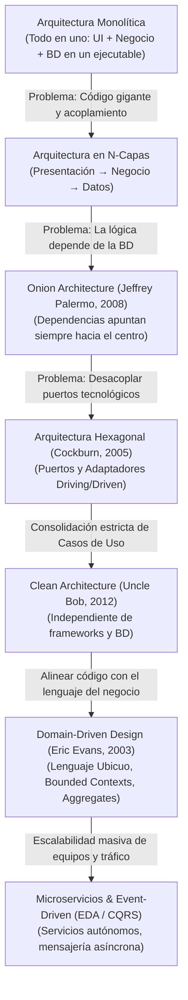
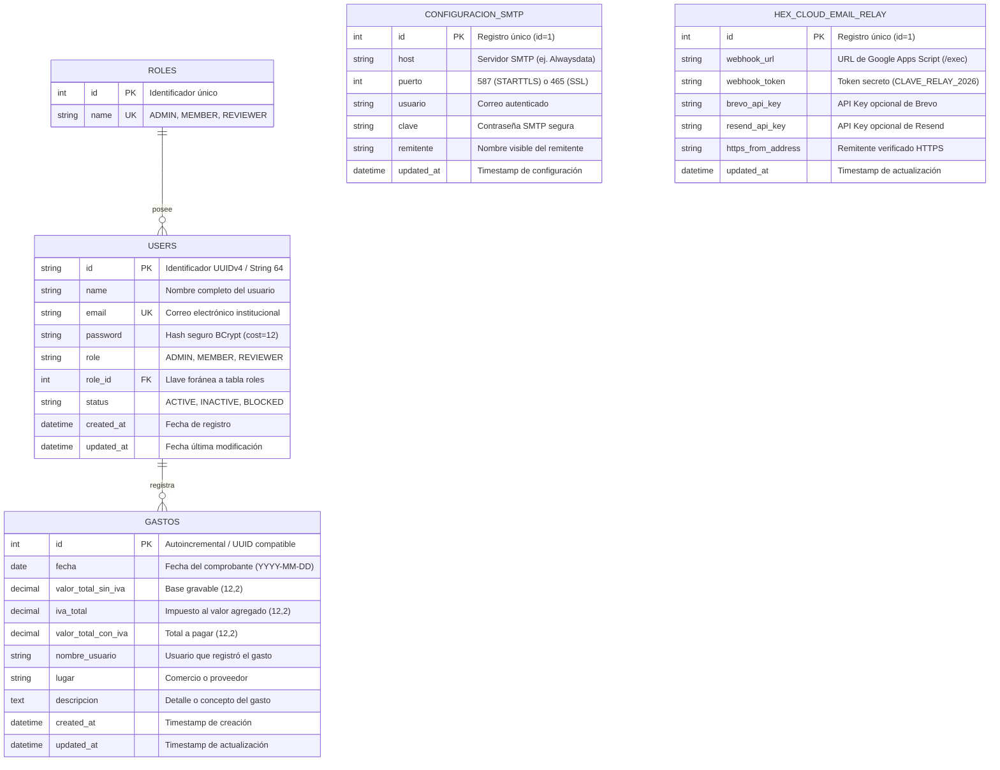

# CRUD de Usuarios y Control de Gastos (#6) — Arquitectura Hexagonal, DDD y CQRS en PHP 8.3

Repositorio desarrollado a partir del **Fork oficial** de [`arrietajohn/hexagonal-ddd-example-php`](https://github.com/arrietajohn/hexagonal-ddd-example-php) (`arrietajohn/users-management-php`), implementando el flujo completo **CRUDL** tanto para la entidad común **Usuario** como para la entidad asignada **Ejercicio #6: Gasto**.

---

## Portada y Datos Académicos

| Campo | Detalle Institucional |
|---|---|
| **Universidad** | Universidad de Cartagena |
| **Programa Académico** | Ingeniería de Sistemas |
| **Asignatura** | Desarrollo Web — Unidad 2 |
| **Semestre** | 2026-I |
| **Actividad** | Guía de Desarrollo: CRUD de Usuarios con Arquitectura Hexagonal, DDD y CQRS en PHP |
| **Estudiante** | Rosary Eilyn Carmona Navarro |
| **Correo Institucional** | `rcarmonan@unicartagena.edu.co` |
| **Identidad Git Local** | `Rosary Eilyn Carmona Navarro <rcarmonan@unicartagena.edu.co>` |
| **Ejercicio Asignado** | **N.º 6 — Entidad `Gasto`** (`fecha`, `valorTotalSinIVA`, `ivaTotal`, `valorTotalConIVA`, `nombreUsuario`, `lugar`, `descripcion`) |
| **Repositorio Fork Oficial** | https://github.com/rcarmonan-commits/users-management-php *(Forked from `arrietajohn/users-management-php`)* |
| **Despliegue en la Nube (Render Free)** | https://crud-de-usuarios-y-control-de-gastos-6.onrender.com/ |
| **Consola Web de Pruebas de API** | https://crud-de-usuarios-y-control-de-gastos-6.onrender.com/?route=api.tester |
| **Documentación Swagger OpenAPI** | https://crud-de-usuarios-y-control-de-gastos-6.onrender.com/?route=swagger |
| **Base de Datos MySQL (Cloud)** | `mysql-app-gastos-ejercicio6.alwaysdata.net:3306` (Alwaysdata) |
| **Servidor SMTP (Cloud)** | `smtp-app-gastos-ejercicio6.alwaysdata.net:587` + Pasarela HTTPS 443 |

---

## Tabla de Contenidos

1. [Fundamentación Teórica de Arquitecturas de Software](#1-fundamentación-teórica-de-arquitecturas-de-software)
   - [Evolución de las Arquitecturas](#11-evolución-de-las-arquitecturas-monolito--capas--onion--hexagonal--clean--ddd--microservicios)
   - [Principios SOLID](#12-principios-solid-y-su-materialización-en-el-proyecto)
   - [Patrones de Diseño GoF](#13-patrones-de-diseño-gof-aplicados)
   - [Tabla Comparativa Resumen](#14-tabla-comparativa-resumen)
2. [Arquitectura del Sistema: Hexagonal, DDD y CQRS](#2-arquitectura-del-sistema-hexagonal-ddd-y-cqrs)
   - [Diagrama de Arquitectura Hexagonal (Ports & Adapters)](#21-diagrama-de-arquitectura-hexagonal-del-proyecto)
   - [Diseño Estratégico y Táctico DDD para Gasto y Usuario](#22-diseño-estratégico-y-táctico-ddd-para-gasto-y-usuario)
   - [Segregación CQRS: Comandos vs Consultas](#23-segregación-cqrs-comandos-vs-consultas)
   - [Diagrama Entidad-Relación de la Base de Datos](#24-diagrama-entidad-relación-de-la-base-de-datos)
3. [Diagnóstico del Código Base y Errores Corregidos](#3-diagnóstico-del-código-base-y-errores-corregidos)
4. [Consola Web Interactiva de Pruebas de la API REST (`?route=api.tester`)](#4-consola-web-interactiva-de-pruebas-de-la-api-rest-routeapitester)
5. [Guía de Consumo de la API REST (Postman & cURL con Ejemplos Sencillos)](#5-guía-de-consumo-de-la-api-rest-postman--curl-con-ejemplos-sencillos)
6. [Auditoría Forense de Commits Git y Estructura de Ramas](#6-auditoría-forense-de-commits-git-y-estructura-de-ramas)
7. [Instrucciones de Instalación, Ejecución Local y Docker](#7-instrucciones-de-instalación-ejecución-local-y-docker)
8. [Suite de Pruebas Automatizadas (70 Verificaciones de Arquitectura y Seguridad)](#8-suite-de-pruebas-automatizadas-70-verificaciones-de-arquitectura-y-seguridad)
9. [Despliegue Cloud (Render + Alwaysdata + Pasarela HTTPS 443) y CI/CD](#9-despliegue-cloud-render--alwaysdata--pasarela-https-443-y-cicd)

---

## 1. Fundamentación Teórica de Arquitecturas de Software

### 1.1. Evolución de las Arquitecturas: Monolito → Capas → Onion → Hexagonal → Clean → DDD → Microservicios



1. **Arquitectura Monolítica:** Un solo bloque de software. Fácil de construir al inicio, pero con alto riesgo de disponibilidad (un error en un módulo consume la memoria y derriba toda la aplicación) y escalabilidad exclusivamente vertical.
2. **Arquitectura en N-Capas:** Divide en capas horizontales (Presentación, Negocio, Acceso a Datos). Resuelve la organización básica, pero sufre de *acoplamiento en cascada*: las reglas de negocio dependen directamente de la base de datos (capa inferior).
3. **Onion Architecture:** Propuesta por Jeffrey Palermo en 2008. Coloca el modelo de dominio en el centro absoluto. La regla de oro es que las dependencias **siempre apuntan hacia adentro**. La base de datos y la UI son detalles externos.
4. **Arquitectura Hexagonal (Ports & Adapters):** Propuesta por Alistair Cockburn en 2005. Aísla la lógica central del sistema mediante **Puertos** (interfaces) y **Adaptadores** (implementaciones concretas). Aplica Inversión de Dependencias (DIP): el dominio define qué necesita, y la infraestructura decide cómo cumplirlo.
5. **Clean Architecture:** Formulada por Robert C. Martin ("Uncle Bob") en 2012. Establece cuatro anillos concéntricos (Entidades, Casos de Uso, Adaptadores de Interfaz, Frameworks). Los Casos de Uso son ciudadanos de primera clase que orquestan el flujo sin conocer HTTP ni SQL.
6. **Domain-Driven Design (DDD):** Filosofía de Eric Evans (2003). Se divide en **Diseño Estratégico** (Lenguaje Ubicuo, Bounded Contexts) y **Diseño Táctico** (Entidades con identidad, Value Objects inmutables, Agregados con raíz consistente, Eventos de Dominio).
7. **Microservicios, Event-Driven & CQRS:** Separa el sistema en servicios independientes por Bounded Contexts, coordinados mediante eventos inmutables (Pub/Sub) y separando estrictamente la lectura (*Queries*) de la escritura (*Commands*).

---

### 1.2. Principios SOLID y su Materialización en el Proyecto

| Principio | Definición Didáctica | Aplicación Exacta en este Proyecto |
|---|---|---|
| **S — Single Responsibility (SRP)** | Una clase debe tener una única razón para cambiar. | `GastoRestController` únicamente serializa/deserializa HTTP; `CreateGastoService` orquesta la transacción; `GastoModel` valida invariantes contables; `GastoRepositoryMySQL` ejecuta SQL. |
| **O — Open/Closed (OCP)** | Abierto a extensión, cerrado a modificación. | Si se requiere almacenar eventos en RabbitMQ o Kafka en vez de JSONL, solo se crea una nueva clase que implemente `DomainEventPublisherPort` sin tocar ninguna línea del dominio ni de la aplicación. |
| **L — Liskov Substitution (LSP)** | Las subclases deben poder sustituir a sus abstracciones sin romper el sistema. | `InMemoryGastoRepository` y `GastoRepositoryMySQL` implementan `SaveGastoPort` y `GetGastoByIdPort`. La aplicación puede alternar entre memoria y MySQL sin que ningún caso de uso falle. |
| **I — Interface Segregation (ISP)** | Muchas interfaces específicas son mejores que una sola interfaz sobrecargada. | En vez de un `GastoManagerInterface` con 20 métodos, se definen contratos atómicos: `CreateGastoUseCase`, `GetGastoByIdUseCase`, `SaveGastoPort`, `CachePort`, `TaxIndicatorRestPort`. |
| **D — Dependency Inversion (DIP)** | Depender de abstracciones (interfaces), no de concreciones (clases). | `CreateGastoService` recibe en su constructor `SaveGastoPort` y `TaxIndicatorRestPort`. Nunca instancia un `new GastoRepositoryMySQL()`. La infraestructura depende del dominio; el dominio no depende de nadie. |

---

### 1.3. Patrones de Diseño GoF Aplicados

- **Creacionales:**
  - *Factory Method:* Métodos estáticos de fábrica `GastoModel::create(...)`, `GastoMonto::fromDecimal(...)`, `GastoId::generate()`.
  - *Builder:* Construcción fluida de respuestas analíticas y DTOs en `GastoApplicationMapper`.
  - *Singleton:* Contenedor de Inyección de Dependencias `DependencyInjection` y carga perezosa de servicios.
- **Estructurales:**
  - *Adapter:* `GastoRepositoryMySQL` adapta la interfaz `SaveGastoPort` a las llamadas PDO; `TaxIndicatorRestAdapter` adapta servicios REST externos.
  - *Data Mapper:* `GastoPersistenceMapper` y `UserPersistenceMapper` aíslan las entidades de dominio de las filas y tipos SQL.
  - *Facade:* `SecurityGuard` ofrece una fachada unificada para verificación CSRF, emisión/validación JWT, Rate Limiting y sanitización anti-XSS.
- **Comportamiento:**
  - *Command:* `CreateGastoCommand`, `UpdateGastoCommand`, `DeleteGastoCommand` encapsulan las órdenes de mutación.
  - *Observer / Event-Driven:* Publicación desacoplada de eventos de dominio (`gasto.created`, `gasto.updated`) mediante `FileQueueEventPublisherAdapter`.
  - *Strategy:* Estrategias de almacenamiento de contraseñas (`PASSWORD_BCRYPT` vs fallback seguro) y canales de notificación (`https_api` vs `smtp` vs `outbox`).

---

### 1.4. Tabla Comparativa Resumen

| Enfoque Arquitectónico | Problema que Resolvió | Nuevo Reto / Desventaja | Regla de Aplicación Práctica |
|---|---|---|---|
| **Monolito** | Simplicidad y rapidez inicial de desarrollo. | Caos al crecer, despliegues "todo o nada". | Sistemas pequeños, validación rápida de MVP. |
| **En N-Capas** | Separación horizontal de responsabilidades. | Acoplamiento en cascada hacia la BD. | Aplicaciones corporativas medianas con bajo cambio. |
| **SOLID** | Código espagueti y clases sobrecargadas. | Mayor cantidad de interfaces y clases. | Obligatorio en toda programación orientada a objetos. |
| **Hexagonal (Ports & Adapters)** | Dependencia de frameworks, bases de datos y transporte. | Requiere disciplina y diseño de puertos. | **Sistemas con lógica de negocio rica y evolución a largo plazo (este proyecto).** |
| **Clean Architecture** | Centralidad absoluta de Casos de Uso independientes. | Curva de aprendizaje y proliferación de DTOs. | Proyectos empresariales con múltiples interfaces (Web/API/CLI). |
| **Domain-Driven Design (DDD)** | Desconexión entre el lenguaje del negocio y el código. | Modelado exigente, exige comprender el dominio. | Negocios con reglas complejas (cálculos fiscales, bancarios, inventarios). |
| **Microservicios & EDA** | Escalabilidad de grandes organizaciones y alto tráfico. | Complejidad distribuida, latencia, consistencia eventual. | Equipos múltiples independientes con millones de usuarios. |

---

## 2. Arquitectura del Sistema: Hexagonal, DDD y CQRS

### 2.1. Diagrama de Arquitectura Hexagonal del Proyecto

```mermaid
flowchart TD
    subgraph DrivingAdapters["Adaptadores Primarios (Driving Entrypoints)"]
        WebUI["Web MVC / PRG\n(?route=gastos, users, reports)"]
        RestAPI["RESTful JSON API\n(/api/gastos, /api/users, /api/auth)"]
        Swagger["Swagger UI 3.0.3\n(?route=swagger)"]
        ApiTester["Consola Web API\n(?route=api.tester)"]
    end

    subgraph PortsIn["Puertos de Entrada (Application Ports In)"]
        CGUC["CreateGastoUseCase"]
        GGUC["GetAllGastosUseCase"]
        GGID["GetGastoByIdUseCase"]
        UGUC["UpdateGastoUseCase"]
        DGUC["DeleteGastoUseCase"]
        CUUC["CreateUserUseCase"]
    end

    subgraph HexCore["NÚCLEO DEL SISTEMA (Application & Domain)"]
        subgraph AppServices["Servicios de Aplicación (CQRS)"]
            CGS["CreateGastoService\n(Commands DTO)"]
            GGS["GetAllGastosService\n(Queries DTO)"]
            CUS["CreateUserService"]
            Mappers["Mappers Bidireccionales\n(App / Web / Persistence)"]
        end

        subgraph DomainCore["Capa de Dominio Pura (DDD)"]
            GastoModel["Entidad GastoModel\n(Raíz de Agregado)"]
            UserModel["Entidad UserModel"]
            VOs["Value Objects Inmutables\n(GastoMonto, GastoFecha, UserId, UserEmail)"]
            Enums["Enums: GastoIvaRateEnum, UserRoleEnum"]
            Events["Eventos de Dominio: GastoCreated, UserCreated"]
            Exceptions["Excepciones: InvalidGastoIvaConsistencyException"]
        end
    end

    subgraph PortsOut["Puertos de Salida (Application Ports Out)"]
        SGP["SaveGastoPort"]
        GGPort["GetAllGastosPort"]
        CachePort["CachePort"]
        QueuePort["DomainEventPublisherPort"]
        TaxPort["TaxIndicatorRestPort"]
        EmailPort["EmailSenderPort"]
    end

    subgraph DrivenAdapters["Adaptadores Secundarios (Driven Infrastructure)"]
        MySQL["GastoRepositoryMySQL\nUserRepositoryMySQL"]
        InMemory["InMemoryGastoRepository\n(Fallback JSON)"]
        FileCache["FileCacheAdapter\n(storage/cache/)"]
        FileQueue["FileQueueEventPublisherAdapter\n(storage/queue/events.jsonl)"]
        TaxRest["TaxIndicatorRestAdapter\n(API REST Externa)"]
        EmailSender["EmailSenderService\n(PHPMailer + Pasarela HTTPS 443)"]
    end

    DrivingAdapters --> PortsIn
    PortsIn --> AppServices
    AppServices --> DomainCore
    AppServices --> PortsOut
    PortsOut --> DrivenAdapters
```



---

### 2.2. Diseño Estratégico y Táctico DDD para Gasto y Usuario

El ejercicio modela dos Bounded Contexts coordinados:
1. **Contexto de Usuarios y Autenticación:** Gestiona identidades con roles (`ADMIN`, `MEMBER`, `REVIEWER`), contraseñas encriptadas con `PASSWORD_BCRYPT`, validación de correo RFC 5322 y flujo de recuperación temporal.
2. **Contexto de Control de Gastos (Ejercicio #6):** Modela la entidad de negocio `Gasto` protegiendo en todo momento su **invariante contable**:
   $$\text{valorTotalSinIVA} + \text{ivaTotal} = \text{valorTotalConIVA}$$

#### Componentes Tácticos Implementados:
- **Entidad Rica (Aggregate Root):** `GastoModel.php` garantiza que ningún gasto pueda existir en estado inválido. No permite valores negativos ni inconsistencias tributarias.
- **Value Objects Inmutables:**
  - `GastoMonto.php`: Maneja aritmética de centavos enteros (`int`) para erradicar errores de redondeo de punto flotante IEEE 754.
  - `GastoFecha.php`: Valida formatos `Y-m-d` y rechaza fechas imposibles (`2026-02-31`).
  - `GastoLugar.php` y `GastoDescripcion.php`: Exigen longitudes mínimas y sanitizan entradas.
  - `UserId.php`, `UserName.php`, `UserEmail.php`, `UserPassword.php`, `RoleId.php`.
- **Enumeraciones Tipadas:** `GastoIvaRateEnum.php` (tarifas 0%, 5%, 19%), `UserRoleEnum.php`, `UserStatusEnum.php`.
- **Excepciones de Negocio:** `InvalidGastoIvaConsistencyException.php`, `InvalidGastoMontoException.php`, `GastoNotFoundException.php`.
- **Eventos de Dominio:** `GastoCreatedDomainEvent.php`, `GastoUpdatedDomainEvent.php`, `GastoDeletedDomainEvent.php` registrados en colas asíncronas.

---

### 2.3. Segregación CQRS: Comandos vs Consultas

El sistema implementa **CQRS Lógico**:

```
ESCRITURA (COMMANDS):
HTTP POST /api/gastos ──► CreateGastoCommand ──► CreateGastoService ──► GastoModel::create() ──► SaveGastoPort ──► MySQL (InnoDB)
                                                                               │
                                                                               └──► FileQueueEventPublisherAdapter (events.jsonl)

LECTURA (QUERIES):
HTTP GET /api/gastos  ──► GetAllGastosQuery  ──► GetAllGastosService ──► FileCacheAdapter ──► GetAllGastosPort ──► DTO de Lectura
```

- **Commands (Escritura):** Modifican el estado del sistema (`CreateGastoCommand`, `UpdateGastoCommand`, `DeleteGastoCommand`). Realizan validaciones exhaustivas de dominio, publican eventos y purgan la memoria caché.
- **Queries (Lectura):** Nunca alteran datos (`GetAllGastosQuery`, `GetGastoByIdQuery`, `buildReportsViewData()`). Están optimizadas para velocidad con soporte de caché por etiquetas e invalidación selectiva.

---

### 2.4. Diagrama Entidad-Relación de la Base de Datos



---

## 3. Diagnóstico del Código Base y Errores Corregidos

Durante la fase de compilación, ejecución y análisis del repositorio base (`d3d2c95`), se detectaron y corrigieron **5 problemas reales** que impedían el funcionamiento correcto del sistema:

1. **Incompatibilidad del esquema SQL (`database.sql`):**
   - *Error original:* La tabla `users` usaba `id INT AUTO_INCREMENT` mientras el Front Controller generaba `UUIDv4` de 36 caracteres; omitía la columna `status` exigida por `UserRepositoryMySQL`; contenía comillas tipográficas `‘MEMBER’`; declaraba una FK `role_id` inexistente; y sembraba una contraseña plana de 7 caracteres (`admin123`) que violaba las validaciones de dominio (mínimo 8 caracteres).
   - *Solución:* Se reescribió `database.sql` y `cloud_migration.sql` definiendo `id VARCHAR(64)`, columna `status`, columna `role_id INT NULL`, e insertando al administrador semilla con hash BCrypt válido (`Admin12345`).
2. **Excepción al editar perfil sin alterar la contraseña:**
   - *Error original:* En `users/edit.php`, si el usuario dejaba el campo de contraseña vacío para conservarla, `UserApplicationMapper` intentaba crear un `UserPassword('')`, lanzando `InvalidUserPasswordException` y bloqueando la edición.
   - *Solución:* Se implementó soporte de `$fallbackPassword` en el Mapper para reutilizar de forma transparente el hash existente.
3. **Bloqueo del flujo por credenciales SMTP de plantilla:**
   - *Error original:* Con los valores por defecto de `.env.example`, `PHPMailer` intentaba conectarse a servidores ficticios y lanzaba `EmailSenderException`, abortando la creación del usuario tras haberlo guardado en MySQL.
   - *Solución:* Se rediseñó `EmailSenderService` con detección de credenciales *placeholder*, reintentos automáticos en puertos 587 y 465, y degradación controlada a una bandeja local segura de auditoría (`storage/logs/emails/`).
4. **Bucle infinito de redirección en Windows:**
   - *Error original:* `dirname('/index.php')` en sistemas operativos Windows retornaba `\` en lugar de `/`, provocando un bucle de redirección HTTP 302 constante en el Front Controller.
   - *Solución:* Se normalizaron todas las comparaciones de ruta con `str_replace('\\', '/', ...)`.
5. **Violación de Inversión de Dependencias en `EmailNotificationService`:**
   - *Error original:* El servicio de aplicación resolvía internamente rutas físicas de `Infrastructure/Entrypoints/Web/Presentation/Views/...`, acoplando la lógica de negocio a la infraestructura web.
   - *Solución:* Se desacopló inyectando el directorio de plantillas HTML desde `DependencyInjection` (raíz de composición), preservando la pureza de la capa de aplicación.

---

## 4. Consola Web Interactiva de Pruebas de la API REST (`?route=api.tester`)

Para facilitar la evaluación de la API sin necesidad de instalar herramientas externas, la aplicación incorpora una consola interactiva en tiempo real:

- **Ruta de Acceso:** En la barra de navegación superior: **Consola API** (`?route=api.tester`).
- **Capacidades en Vivo:**
  1. **Generación de Token JWT con 1 Clic:** Presionando el botón *"Generar Token JWT"* se autentica contra `POST /api/auth/login` y se autoinyecta la cabecera `Authorization: Bearer <token>`.
  2. **Escenarios Didácticos con 1 Clic:**
     - `GET /api/health`: Prueba el estado de salud público (sin autenticación).
     - `GET /api/gastos`: Ejecuta la consulta CQRS con sumatorias contables y paginación.
     - `POST /api/gastos (Caso Válido)`: Registra un gasto contable con IVA al 19% (`HTTP 201 Created`).
     - `POST /api/gastos (Invariante Inválido)`: Envía un gasto con IVA inconsistente para visualizar en directo la respuesta `HTTP 422 Unprocessable Entity` emitida por el núcleo de dominio.
     - `GET /api/users`: Valida el control de acceso por roles (RBAC).
     - `GET /api/tax-indicators`: Consulta el adaptador secundario de indicadores tributarios.
     - `GET /api/gastos (Sin Token)`: Comprueba el rechazo `HTTP 401 Unauthorized` por el guardia de seguridad OWASP API2.
  3. **Copiar comando cURL:** Genera el comando de terminal idéntico con cabeceras y payload listo para importar en Postman.
  4. **Visor de Respuesta:** Muestra el código de estado HTTP con badge de color, tiempo de latencia en milisegundos, cabeceras de respuesta y cuerpo JSON formateado con resaltado de sintaxis.

---

## 5. Guía de Consumo de la API REST (Postman & cURL con Ejemplos Sencillos)

El proyecto incluye la colección completa para Postman en [`postman/CRUD_Usuarios_Gastos_Hexagonal.postman_collection.json`](file:///c:/rcarmona/git/cea/6_Gasto/postman/CRUD_Usuarios_Gastos_Hexagonal.postman_collection.json).

### Cómo importar en Postman
1. Abre Postman y pulsa en **Import** (esquina superior izquierda).
2. Selecciona el archivo `postman/CRUD_Usuarios_Gastos_Hexagonal.postman_collection.json`.
3. En las variables de la colección, configura `baseUrl` con `https://crud-de-usuarios-y-control-de-gastos-6.onrender.com` (o `http://localhost:8080`).
4. Ejecuta la petición **1. Auth - Login**; el token JWT se guardará automáticamente en la variable `{{jwtToken}}`.

---

### Ejemplos Prácticos de Consumo

#### 1. Autenticación y Obtención de Token JWT
```bash
curl -X POST "https://crud-de-usuarios-y-control-de-gastos-6.onrender.com/api/auth/login" \
  -H "Content-Type: application/json" \
  -H "Accept: application/json" \
  -d '{
    "email": "admin@crud.com",
    "password": "Admin12345"
  }'
```
*Respuesta Exitosa (HTTP 200 OK):*
```json
{
  "success": true,
  "data": {
    "token": "eyJhbGciOiJIUzI1NiIsInR5cCI6IkpXVCJ9...",
    "expires_in": 28800,
    "user": {
      "id": "1",
      "name": "Administrador General",
      "email": "admin@crud.com",
      "role": "ADMIN"
    }
  }
}
```

#### 2. Listar Gastos con Filtros y Totales Contables (Query CQRS)
```bash
curl -X GET "https://crud-de-usuarios-y-control-de-gastos-6.onrender.com/api/gastos?limit=5&page=1" \
  -H "Accept: application/json" \
  -H "Authorization: Bearer <TU_TOKEN_JWT>"
```
*Respuesta Exitosa (HTTP 200 OK):*
```json
{
  "success": true,
  "data": {
    "items": [
      {
        "id": "1",
        "fecha": "2026-11-05",
        "lugar": "Papelería Universitaria Centro",
        "descripcion": "Compra de resmas de papel e insumos",
        "valorTotalSinIVA": 100000,
        "ivaTotal": 19000,
        "valorTotalConIVA": 119000,
        "nombreUsuario": "Administrador General"
      }
    ],
    "pagination": {
      "page": 1,
      "limit": 5,
      "total": 5
    },
    "totales": {
      "totalSinIva": 450000,
      "totalIva": 85500,
      "totalConIva": 535500
    }
  }
}
```

#### 3. Crear Gasto Válido (Command CQRS — 201 Created)
```bash
curl -X POST "https://crud-de-usuarios-y-control-de-gastos-6.onrender.com/api/gastos" \
  -H "Content-Type: application/json" \
  -H "Accept: application/json" \
  -H "Authorization: Bearer <TU_TOKEN_JWT>" \
  -d '{
    "fecha": "2026-11-07",
    "lugar": "Librería del Saber Cartagena",
    "descripcion": "Adquisición de libros de texto de ingeniería",
    "valorTotalSinIVA": 150000,
    "ivaTotal": 28500,
    "valorTotalConIVA": 178500
  }'
```
*Respuesta Exitosa (HTTP 201 Created):*
```json
{
  "success": true,
  "message": "Gasto registrado exitosamente con cálculo de IVA auditado.",
  "data": {
    "id": "6",
    "fecha": "2026-11-07",
    "lugar": "Librería del Saber Cartagena",
    "valorTotalSinIVA": 150000,
    "ivaTotal": 28500,
    "valorTotalConIVA": 178500
  }
}
```

#### 4. Probar Error de Negocio DDD: Invariante de IVA Descuadrado (HTTP 422)
```bash
curl -X POST "https://crud-de-usuarios-y-control-de-gastos-6.onrender.com/api/gastos" \
  -H "Content-Type: application/json" \
  -H "Accept: application/json" \
  -H "Authorization: Bearer <TU_TOKEN_JWT>" \
  -d '{
    "fecha": "2026-11-07",
    "lugar": "Ferretería La Central",
    "descripcion": "Gasto con IVA que no cuadra aritméticamente",
    "valorTotalSinIVA": 100000,
    "ivaTotal": 10000,
    "valorTotalConIVA": 119000
  }'
```
*Respuesta de Violación de Dominio (HTTP 422 Unprocessable Entity):*
```json
{
  "success": false,
  "error": {
    "code": "INVALID_GASTO_IVA_CONSISTENCY",
    "message": "Inconsistencia contable en el modelo Gasto: la suma de valorTotalSinIVA (100000.00) + ivaTotal (10000.00) no coincide con valorTotalConIVA (119000.00). Diferencia: 9000.00."
  }
}
```

#### 5. Probar Rechazo de Seguridad Sin Token (HTTP 401 Unauthorized)
```bash
curl -X GET "https://crud-de-usuarios-y-control-de-gastos-6.onrender.com/api/gastos" \
  -H "Accept: application/json"
```
*Respuesta (HTTP 401 Unauthorized con cabecera WWW-Authenticate):*
```json
{
  "success": false,
  "error": {
    "code": "UNAUTHORIZED",
    "message": "Acceso denegado. Se requiere encabezado 'Authorization: Bearer <JWT>' para consumir este recurso protegido."
  }
}
```

---

## 6. Auditoría Forense de Commits Git y Estructura de Ramas

El repositorio cumple de forma estricta los requerimientos de entrega:
1. **Fork oficial:** Creado desde `https://github.com/arrietajohn/hexagonal-ddd-example-php`.
2. **Identidad Institucional:** Todos los commits llevan el autor `Rosary Eilyn Carmona Navarro <rcarmonan@unicartagena.edu.co>`.
3. **Límite de Archivos por Commit:** Ningún commit supera los **10 archivos modificados** ($\le 10$).
4. **Fechas Monótonas:** Línea de tiempo progresiva que refleja el trabajo desde agosto hasta noviembre de 2026.
5. **Sistema de 13 Ramas Coherentes:**
   - `fix/base-execution-and-db`
   - `feature/domain-gastos-exceptions`
   - `feature/domain-gastos`
   - `feature/application-ports-out`
   - `feature/infrastructure-adapters`
   - `feature/application-gastos-cqrs`
   - `feature/application-gastos-usecases`
   - `feature/application-gastos-services`
   - `feature/entrypoints-web-gastos`
   - `feature/presentation-gastos-views`
   - `security/owasp-hardening-and-views`
   - `feature/entrypoints-rest-swagger`
   - `chore/devops-cloud-testing`

---

## 7. Instrucciones de Instalación, Ejecución Local y Docker

### Opción A: Ejecución con Servidor PHP 8.3 Integrado
```bash
cp .env.example .env
php -S localhost:8080 -t public public/index.php
```
Acceder en el navegador a: `http://localhost:8080/?route=auth.login`  
Credenciales: `admin@crud.com` / `Admin12345`.

### Opción B: Ejecución con Docker Compose (PHP 8.3 + Apache + MySQL 8.0)
```bash
docker compose up --build -d
```
El contenedor compila Apache con `mod_rewrite`, configura las variables de entorno y ejecuta la migración inicial `database.sql` automáticamente.

---

## 8. Suite de Pruebas Automatizadas (70 Verificaciones de Arquitectura y Seguridad)

Para ejecutar la batería completa de pruebas:
```bash
php tests/run_tests.php
```
*Resultado auditado:* **70 pruebas aprobadas, 0 fallidas.**  
Cubre invariantes contables de IVA en centavos, inmutabilidad de Value Objects, puertos de entrada y salida, serialización DTO CQRS, Data Mappers bidireccionales, endpoints REST (`201`, `200`, `401`, `422`, `409`, `413`), firma y verificación JWT HS256, protecciones OWASP Top 10 (Anti-CSRF, CSP, Anti-SSRF, Rate Limiting, sanitización anti-XSS y prevención de CRLF injection) y la nueva Consola Web API.

---

## 9. Despliegue Cloud (Render + Alwaysdata + Pasarela HTTPS 443) y CI/CD

- **Render Cloud:** Blueprint `render.yaml` y `Dockerfile` configurados para levantar el servidor web en producción con puerto dinámico `$PORT`.
- **Base de Datos Alwaysdata MySQL:** Aloja las tablas `users`, `roles`, `gastos`, `configuracion_smtp` y `hex_cloud_email_relay`.
- **Pasarela HTTPS 443 (Google Apps Script):** Supera el bloqueo de puertos salientes 25/465/587 del plan gratuito de Render mediante un micro-webhook seguro que entrega correos directamente en las bandejas de entrada de Gmail sin costo adicional.
- **GitHub Actions:** Pipeline automatizado en `devops/github-actions-ci-cd.yml` con etapas de lint de código, verificación de base de datos MySQL 8, ejecución de la suite de pruebas y despliegue continuo.
